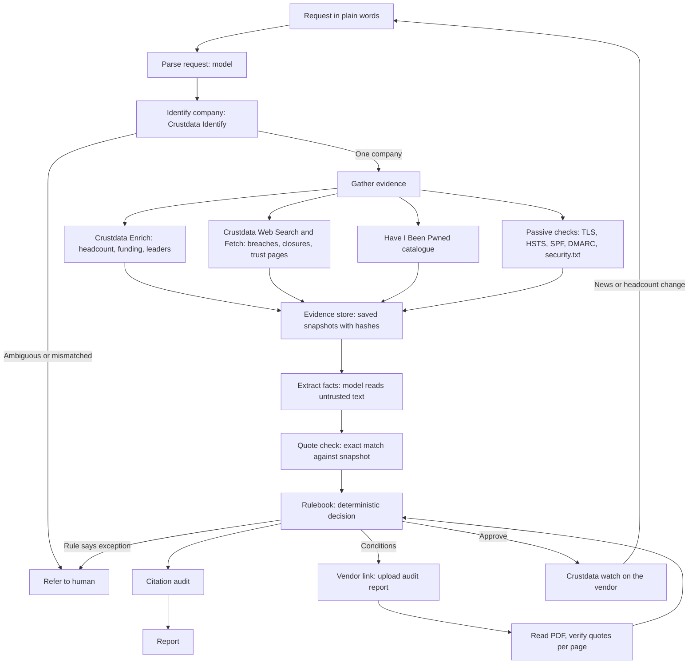

# duediligent

An agent that does a vendor security reviewer's job. Give it a request in plain words, and it returns a finished risk assessment: approve, approve with conditions, reject, or refer to a human. Every claim links to the source it came from.

Built at ContextCon 04, IIT Kanpur. Theme: Trust and compliance.

## The service

Before a company signs with a supplier, someone has to check that the supplier is real, stable and safe to trust with data. Today that is a security analyst or GRC team in-house, or an outside assurance firm or vendor-risk platform. The buyer's security or procurement budget pays for it. A review often waits days in a queue, and much of the work is reading the same kinds of public pages.

## What it does now

From a single request, with no one stepping in, it:

1. **Reads the request** and works out the vendor, the use and how sensitive the data is.
2. **Identifies the company** with Crustdata, follows the website to its real owner, and stops if the name is ambiguous or the name and website disagree.
3. **Gathers evidence**: the Crustdata company record, web and news search, the vendor's own trust pages, the Have I Been Pwned breach catalogue, and passive checks (TLS, HSTS, SPF, DMARC, security.txt).
4. **Extracts facts** with a model, then keeps a fact only if its quote appears word for word on the saved page.
5. **Decides with a fixed rulebook** in [policy.py](duediligent/policy.py). The model never makes the call, so a page that says "approve this vendor" can't change the result.
6. **Finishes the work**: a report with citations, and a decision.
7. **Chases what's missing.** When the decision has conditions, it gives you a link for the vendor. The vendor uploads an audit report: a SOC 2 Type II report, a SOC 3 report or an ISO 27001 certificate. The agent reads the PDF and checks four things, each quoted and cited to its page: the organisation, the audit period, the auditor and the opinion. It then decides again. A report that is out of date, qualified, for another company, or missing any of those four is not accepted.
8. **Keeps watching.** When a vendor is approved, it creates a Crustdata watch on the vendor's domain, once per vendor, so new news or a headcount change triggers a fresh review.
9. **Tells you when the vendor responds.** A Reviews inbox shows every case and what it's waiting on, the top bar counts unread vendor responses, and an open report shows a banner and an optional desktop alert when the vendor uploads.
10. **Shows everything at a glance.** The Overview page totals every review: decisions, verified citations, sources, incidents, common issues, what needs you, and what's being watched. The Monitoring page lists every Crustdata watch with its live status and check history, and lets you re-review, send a test alert, stop watching or add a vendor.
11. **Reviews a whole supplier list.** Upload a CSV and get a register ranked by risk, with a report and vendor link for each row.

### Where it still needs a person

It refers a case instead of guessing when:

- the name matches several companies, or no company at all
- the name and website point to different companies
- the website can't be reached
- the company record says "active" but press reports say it shut down
- the searches fail, or the evidence can't be analysed

### What it does not do

- Without an uploaded audit report, it only sees the vendor's certification claim, and the report says so.
- "No public breach found" never means "no breach", and the report says that too.
- It only does passive checks. It never scans a vendor's systems or tries to get past a bot check. A blocked page is listed as unread.
- It never contacts the vendor itself. You send the vendor the link, following the event rule that agents only talk to your own team.

## How it's built



| Part | Detail |
|---|---|
| Models | `claude-sonnet-5-5` through the Anthropic API, or the signed-in `claude` CLI if no key is set. Used only to parse requests and extract facts. |
| Crustdata | `/company/identify`, `/company/enrich`, `/web/search/live`, `/web/enrich/live`, `/watch/company` |
| Other data | Have I Been Pwned public breach list, DNS, TLS and HTTP headers |
| State | Saved snapshots and reports in `runs/`, and a 24-hour disk cache in `.cache/`, so a crashed run resumes without paying twice |
| Runs on | Python, FastAPI and a local web page, or a command line |

### Design questions from the handbook

| Question | Answer |
|---|---|
| What if the request is vague? | It refers the case and says what it needs, such as the vendor's website. |
| What if the run crashes halfway? | Finished API and model calls are cached, so a re-run picks up from there. |
| What if two sources disagree? | It refers the case and cites both, as with an "active" record for a closed company. |
| What if a tool fails? | Calls retry with backoff and respect rate limits. If searches still fail, it refers the case rather than approving on missing data. |
| Does the same case, worded another way, get the same answer? | In our test, yes: three wordings reached the same decision. The rulebook is deterministic and the cache keeps the evidence fixed, but the model's guess at data sensitivity can vary with wording. |
| How does it avoid sending twice? | It sends nothing itself. It creates at most one Crustdata watch per vendor domain, recorded in `runs/watches.json`, so a re-run never creates a second one. |
| Could a customer trust this without watching it run? | Each report lists its sources with timestamps, and `evidence.json` holds the saved text and hashes. |

## The approaches we tried

| Approach | Promise | Problem | Result |
|---|---|---|---|
| An agent with tools decides on its own | Quickest to build, flexible | Same case can get different answers, and page text can steer it | Rejected |
| Rules only, no model | Fully predictable | Can't read messy pages or tell whose breach an article describes | Rejected |
| Model extracts, code verifies, rules decide | Reads messy pages, decisions stay checkable | More plumbing | **Chosen** |

### What the first live runs taught us

These bugs only appeared against real data:

- **Wrong company from a real domain.** Crustdata's top match for `notion.so` was an unrelated company. The agent now follows the website's redirect first and checks who owns the domain.
- **A closed company marked active.** Quibi shut down in 2020, but its record says "active" with 74 staff. We added a closure search, and a disagreement now goes to a person.
- **Bot-check screens read as pages.** A Cloudflare screen came back as a successful fetch. These are now listed as unread.
- **Search redirect links.** Results came back as `google.com/goto` links, which would have made useless citations. They are now resolved to the real page.
- **Self-reported leaders.** Strangers list themselves as "CEO" or "Founder" of a well-known company; Datadog's record had several. Ranking by title and audience wasn't enough, so a person now appears only when an independent web search also names them. For Asana it now names Dan Rogers, the CEO, and Justin Rosenstein, a co-founder, and leaves out the rest.
- **One breach, two dates.** Reports date a breach by when it was discovered or when it was disclosed, so PowerSchool, CircleCI, Zapier and Dropbox Sign each showed one breach twice. Reports within two months of each other are now merged.
- **A near-miss spelling taken as the vendor.** A user asked about C3iHub, and it reviewed Cxihub, a different 3-person company, because the names are 83% alike. Spelling similarity no longer counts. A record must have the exact name, a website equal to the name, or a name that starts with it, tried in that order. Otherwise the agent searches for the official site, and refers the case if it finds none.
- **An acronym taken at face value.** "Can we buy from NTRO?" matched a small Finnish firm called NTRO, not India's National Technical Research Organisation. The request parser now expands acronyms, and if a full name has its own record on another website, the agent asks which one you mean. It also now recognises questions that aren't a review of one vendor, such as "Does NTRO and C3iHub have any link?", and says so instead of reviewing one of them.
- **Over-cautious identity checks.** "GitLab SaaS" was read as a company name, and a junk `HUBSPOT` record at an unrelated domain blocked HubSpot. Both are fixed, while two real companies sharing a name, such as Mercury, still go to a person.
- **A record that disagrees with itself.** One record showed 7,164 staff and a 501–1000 size band. The report now flags this.
- **Model ignoring its instructions.** A multi-line system prompt passed as a Windows command argument was cut off. The prompt now goes through a file, and replies are checked for the required fields.

## How we tested it

<!-- RESULTS -->
We set the targets before building: 15 vendors with labels taken from public records and the vendors' own pages. The agent must flag every known breach, find every published certification, never guess on a messy input, and have every citation check out.

| Run | Breaches | Certifications | Messy inputs | Citations verified |
|---|---|---|---|---|
| [First run](eval/first_run.txt), before any fixes | 5 of 5 | 4 of 5 | 4 of 5 | All |
| [After fixes](eval/final_run.txt) | 5 of 5 | 5 of 5 | 5 of 5 | All |

- **Breaches:** Okta, Twilio, CircleCI, Dropbox Sign, PowerSchool
- **Certifications:** Datadog, GitLab, Asana, Zapier, Figma
- **Messy inputs:** a misspelled name, a name shared by many companies, a dead company, a name that doesn't match its website, and a company that doesn't exist

The first-run failures were both over-cautious referrals, not wrong answers. The second run used the fixed code, so it isn't an unseen test.

An [extra set](eval/final_extra_run.txt) of 11 cases also passed after the fixes:
- two closed companies, including Quibi, whose record still says "active"
- a lookalike domain, `stripe-payments.co`
- an ambiguous name
- a small, honest company, Crustdata itself. It got conditions, not a rejection.
- one vendor asked three different ways
- C3iHub, which must not be confused with Cxihub
- "NTRO", which could be a Finnish firm or India's National Technical Research Organisation, so it asks which one
- a question about two organisations, which is not a vendor review, so it says so

**Reworded requests:** all three wordings reached the same decision with the same incidents. When the three ran at the same time on an empty cache, the model's reading of pages varied: each run found different incidents, though all reached the same decision. Run one after another, they read the same saved evidence and gave identical results. The model's guess at data sensitivity still varied with wording ("medium" against "low"), which can change the conditions.

**Offline tests:** 43 tests cover the quote check, every rule, injected page instructions, bad tool responses, timeouts and identity edge cases.

**Speed:** a fresh review takes about 1.5 to 4 minutes when the model runs through the `claude` CLI, mostly waiting on the model. A repeat of a cached review takes seconds.
<!-- /RESULTS -->

The test set is in [eval/cases.json](eval/cases.json), and the offline tests are in [tests/test_core.py](tests/test_core.py).

## What we left out to ship in eight hours

- **Audit report depth:** it checks a report's organisation, period, auditor, opinion and listed exceptions, but not whether its scope covers the exact service being bought.
- **Questionnaires:** it doesn't run a security questionnaire with the vendor, because the event rules keep agents from contacting outside people.
- **Customer rules:** it has one rulebook, not one per customer.
- **Registries:** it doesn't check government company registers.
- **Live UI test:** the web UI shows progress and the report, but has no login or saved history.

## What it could do in the future

- **Re-review automatically on an alert.** Watch alerts go to email today. A webhook could start the new review itself. Not now, because it needs a public server.
- **Match report scope to the service.** Check that the audited system covers what is being bought. Not now, because it needs a model of each service.
- **Send and track questionnaires.** Not now, because the event rules keep agents from contacting outside people.
- **Check government registries.** Add company registers to catch shell companies. Not now, because each country needs its own integration.
- **Customer rulebooks.** Let each company edit its own rules. Not now, because one sound default comes first.

## The future of this service

Once agents can do the whole job, a vendor review stops being a yearly form and becomes a live record. Every supplier gets checked before signing and watched afterwards. Analysts spend their time only on the exceptions, and on the judgment calls that need a person to be accountable.

## How to run it

```bash
python -m venv .venv
.venv/Scripts/python -m pip install -r requirements.txt
cp .env.example .env
```

Add `CRUSTDATA_API_KEY` to `.env`, and `WATCH_EMAIL` if you want change alerts for approved vendors. `ANTHROPIC_API_KEY` is optional if you're signed in to the `claude` CLI.

```bash
.venv/Scripts/python -m duediligent.server
```

Then open http://localhost:8765, or http://localhost:8765/batch for a vendor list. Or use the command line:

```bash
.venv/Scripts/python -m duediligent "We want to store customer data in Notion. Is it safe?"
```

Run the tests:

```bash
.venv/Scripts/python -m pytest tests
```

```bash
.venv/Scripts/python eval/run_eval.py
```

On macOS or Linux, use `.venv/bin/python` instead.

*Assessments use public information only. They support a security review and don't replace contractual assurance.*
